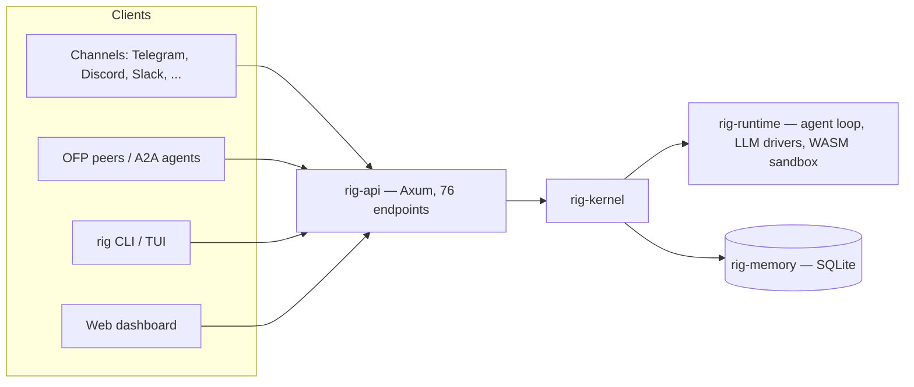

<div align="right">

[](#license)

</div>

# Rig — the Agent Operating System

**An open-source Agent OS in Rust.** Not a chatbot framework, not a Python wrapper around an LLM — a 14-crate workspace that compiles to a single-binary daemon for autonomous agents that run 24/7 on schedules: persistent memory, 40 messaging channels, bundled skills, workflows and triggers, MCP tools, an A2A peer network, and a live web dashboard.

> **Fork note:** this repo is a fork of Rig (upstream: [RightNow-AI/rig](https://github.com/RightNow-AI/rig)). Repo home: [toxicwind/rig](https://github.com/toxicwind/rig). Binary, crate, and config names intentionally stay `rig` for ecosystem compatibility.

## Why should I care?

- **Agents that work while you sleep** — scheduled/periodic agent loops, triggers, and a supervisor with health monitoring, not one-shot prompts
- **Infrastructure-grade Rust** — Axum API server, WASM-sandboxed tools with dual fuel + epoch metering, RBAC auth, GCRA rate limiting, Merkle-hash audit trail
- **Bring your own model** — 3 native drivers (Anthropic, Gemini, OpenAI-compatible) covering 20 providers; one key is enough to start (Groq has a free tier)
- **Speaks the protocols** — OpenAI-compatible endpoints, MCP client and server, and A2A agent cards for agent-to-agent work

## Features

- **Agent lifecycle** — spawn, list, chat, clone, kill; per-agent mode switching (Full / Assist / Observe)
- **Memory substrate** — SQLite (schema v5): structured KV, semantic search with vector embeddings, knowledge graph, sessions, task board, usage events
- **Tools & sandbox** — built-in tools (filesystem, web search/fetch with SSRF protection, shell, scheduling, inter-agent) plus MCP servers; WASM sandbox via Wasmtime
- **Workflows & triggers** — pipelines with branching, fan-out parallelism, loops, variable expansion, and event-pattern triggers with fire limits
- **40 channel adapters** — Telegram, Discord, Slack, WhatsApp, Signal, Matrix, Email, SMS, IRC, and more, with per-user rate limiting and output formatters
- **60 bundled skills** — `skill.toml` + Python/WASM/Node/Prompt-only bundles, SHA256-verified manifests, prompt-injection scanning
- **OFP peer network** — JSON-framed peer-to-peer agent networking over TCP with HMAC-SHA256 mutual auth (`rig-wire`)
- **Live dashboard** — every agent visible at a glance; desktop app (Tauri 2.0) and ratatui TUI included

## Architecture



### Crates

| Crate | Role |
|-------|------|
| `rig-types` | Shared types: manifests, capabilities, events, taint tracking, model catalog, config |
| `rig-memory` | SQLite memory substrate, sessions, semantic search, usage tracking |
| `rig-runtime` | Agent loop, 3 LLM drivers, WASM sandbox, MCP client, A2A, web tools |
| `rig-kernel` | Central coordinator: registry, scheduler, supervisor, workflows, triggers, metering, RBAC |
| `rig-api` | Axum HTTP API: 76 endpoints, WS + SSE streaming, auth, rate limiting |
| `rig-channels` | 40 channel adapters, bridge manager, formatters, rate limiter |
| `rig-wire` | OFP peer-to-peer networking with HMAC-SHA256 auth |
| `rig-skills` | 60 bundled skills, registries, verification, injection scanning |
| `rig-migrate` | One-command migration from OpenClaw (`rig migrate --from openclaw`) |
| `rig-desktop` | Tauri 2.0 desktop app (tray, notifications, single-instance) |
| `rig-hands` | Curated autonomous capability packages |
| `rig-extensions` | One-click MCP server setup, credential vault, OAuth2 PKCE |
| `rig-cli` | Clap CLI + ratatui TUI, daemon auto-detect, MCP server mode |
| `xtask` | Build automation (cargo-xtask pattern) |

## Quick start

```bash
cargo build --release -p rig-cli
# Binary: target/release/rig

export GROQ_API_KEY="your-key"     # or ANTHROPIC_API_KEY / OPENAI_API_KEY / GEMINI_API_KEY
rig init && rig start
# Dashboard live at http://127.0.0.1:4200
```

Docker (`docker-compose.yml`) and a hardened systemd unit (`deploy/rig.service`) are in-tree.

## Configuration

Config lives at `~/.rig/config.toml` — start from [`rig.toml.example`](rig.toml.example). Highlights:

- `[default_model]` — provider, model id, `api_key_env`, optional `base_url`
- `api_key` — enables Bearer auth (strongly recommended when exposing); non-loopback requests without auth are rejected by default (`RIG_ALLOW_NO_AUTH=1` to opt out)
- `[network]` — OFP peer listening; `RIG_LISTEN=0.0.0.0:4200` overrides the API bind
- `[compaction]`, `[telegram]`/`[discord]`/`[slack]`, `[[mcp_servers]]` — sessions, channels, MCP

## Machine-readable surfaces

| Surface | Where |
|---------|-------|
| REST / WS / SSE | 76 endpoints under `/api` — see [docs/api-reference.md](docs/api-reference.md) |
| OpenAI-compatible | `POST /v1/chat/completions`, `GET /v1/models` |
| A2A | `GET /.well-known/agent.json` (Agent Card), `/a2a/*` task routes |
| MCP | client connections via `[[mcp_servers]]`; built-in server mode via `rig mcp` |
| Health | `GET /api/health` → `{"status":"ok","version":"..."}` |

## Agents & examples

`agents/` ships 30 pre-built agent templates across 4 performance tiers (researcher, coder, planner, recruiter, orchestrator, and more) with `registry.toml`. Runnable samples live in [`examples/`](examples/) — `quick-chat`, `agent-definition`, `admit-agent`.

## Documentation

Full docs live in [`docs/`](docs/README.md): getting started, configuration reference, CLI reference (every subcommand), architecture, agent templates, workflows, channel adapters, providers, skill development, MCP & A2A, API reference, desktop app, security (16 defense-in-depth systems), production checklist, and troubleshooting. Migrating from OpenClaw/LangChain/AutoGPT? See [`MIGRATION.md`](MIGRATION.md).

## Development

```bash
cargo build --workspace --lib                            # compile
cargo test --workspace                                   # all tests pass
cargo clippy --workspace --all-targets -- -D warnings    # zero warnings
```

## On this estate

- Runs as pitchfork daemon **`daemons.rig`** (`pens/estate/pitchfork.toml`): `~/.local/bin/rig start`, `boot_start = true`, kernel port **25196** (`RIG_KERNEL_PORT`), config via `RIG_CONFIG=/home/toxic/.rig/config.toml`
- `~/.local/bin/rig` is a symlink into the mbx release target (bin contract — never a copy)
- Daemon answers `http://127.0.0.1:25196/api/health` and serves the dashboard on the same port

## License

Dual-licensed under [Apache-2.0](LICENSE-APACHE) OR [MIT](LICENSE-MIT).

---

> **Correction (2026-10-31):** an earlier version of this README described the OpenFang estate-notes directory (upstream `RightNow-AI/openfang`, `axiom` on :25103, `coyote` on :25143) — that content belonged to a different product and was wrong for this directory. This is the rig workspace itself: 14 checked-in Rust crates, not estate-side notes. OpenFang estate notes live in the openfang product directory.
